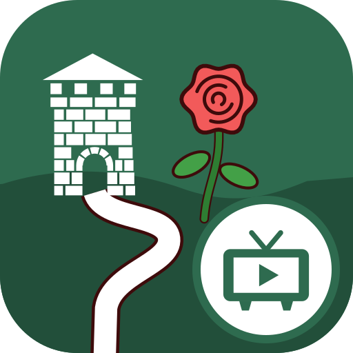

<p align="center">
  
</p>

<h1 align="center">Rosenweg Kiosk</h1>

<p align="center">
  Startseite mit PIN für die Info-Fernseher der Siedlung Rosenweg in Kaiseraugst:<br>
  Diashow sofort nach dem Einschalten, alles andere nur mit PIN.
</p>

---

## Inhalt

- [Was die App macht](#was-die-app-macht)
- [Bedienung](#bedienung)
- [Einrichten am Fernseher](#einrichten-am-fernseher)
- [Als Startseite (HOME) festlegen](#als-startseite-home-festlegen)
- [Mit Rosenweg verbinden (/stationen)](#mit-rosenweg-verbinden-stationen)
- [Updates](#updates)
- [Bauen](#bauen)
- [Neue Version](#neue-version)
- [Aufbau](#aufbau)
- [Lizenz](#lizenz)

## Was die App macht

Rosenweg Kiosk ist eine kleine Android-TV-App (Google TV, z. B. Chromecast mit Google TV). Sie wird als Startseite eingerichtet und startet sofort die Diashow-App, standardmässig [SlideShow](https://slideshow.digital) (`sk.mimac.slideshow`). Wer die Diashow verlässt, landet auf einem PIN-Schirm statt auf dem Google-TV-Startbildschirm.

| Situation | Was passiert |
|---|---|
| Fernseher eingeschaltet | Diashow startet direkt |
| Diashow verlassen (Zurück, Home) | PIN-Schirm mit Ziffernfeld |
| Home-Taste irgendwo (Diashow, andere App, Kiosk-Menü) | immer PIN-Schirm, nie direkt die App-Liste |
| PIN-Schirm 30 s ohne jede Eingabe | zurück zur Diashow; jede Taste (Ziffer, Steuerkreuz, Fokuswechsel) startet die 30 s neu |
| Falsche PIN | Meldung; ab dem 3. Fehlversuch Wartezeit (30 s, dann doppelt so lang, höchstens 15 min) |
| Richtige PIN | Kacheln: „Diashow starten“, Android-„Einstellungen“, „Kiosk-Einstellungen“ und alle installierten TV-Apps |
| hinter der PIN (Apps, Einstellungen, PIN ändern, Diashow-App wählen) | kein 30-s-Zähler; erst nach 10 min ohne jede Bedienung zurück zur Diashow, jede Taste startet die 10 min neu |
| andere App offen (z. B. Android-Einstellungen, Netflix) oder Systemfenster darüber | der Kiosk wartet und funkt nicht dazwischen; kommt man nach mehr als 10 min zurück, erscheint der PIN-Schirm |
| Kiosk-Einstellungen | PIN ändern, Diashow-App wählen, mit Rosenweg verbinden, nach Updates suchen |
| auf /stationen gesperrt | nur ein Sperrhinweis — keine Diashow, kein PIN-Schirm, keine Taste wirkt (auch ohne Netz und nach dem Neustart) |
| noch keine PIN und nicht verbunden | statt des PIN-Schirms der Kopplungscode; die PIN setzt dann Technik auf /stationen |

Die PIN (4 bis 8 Ziffern) liegt nur als Hash (PBKDF2-HMAC-SHA256 mit zufälligem Salz) im privaten Speicher der App. Im Repo steht keine PIN; die erste PIN kommt per adb oder von /stationen. Ohne PIN lässt sich der Kiosk nicht entsperren.

Ohne Verbindung zu Rosenweg läuft die App ganz für sich. Verbunden (siehe [unten](#mit-rosenweg-verbinden-stationen)) erscheint sie auf /stationen und lässt sich dort steuern; fällt das Netz aus, läuft sie mit dem letzten Stand weiter. Sie läuft auch auf Handys und Tablets (kein Touchscreen oder Leanback verlangt), ist aber für die Fernbedienung gebaut: grosse Schrift, deutlicher Fokus, Ziffern auch direkt über die Zifferntasten der Fernbedienung.

## Bedienung

| Taste | PIN-Schirm | Apps | Kiosk-Einstellungen |
|---|---|---|---|
| Steuerkreuz + Mitte | Ziffer, ⌫ oder OK wählen | Kachel öffnen | Punkt wählen |
| Zifferntasten | Ziffer eingeben, Fokus springt auf OK | – | – |
| Zurück | Eingabe löschen, sonst Diashow | Diashow | zurück zu den Apps |
| Home (wenn Kiosk Startseite ist) | bleibt auf dem PIN-Schirm | PIN-Schirm (Freigabe weg) | PIN-Schirm (Freigabe weg) |

> **Hinweis zu SlideShow:** SlideShow fängt die Zurück-Taste selbst ab (getestet mit 4.12.8 auf Google TV: Zurück bleibt in der Diashow). Den PIN-Schirm erreicht man dann mit der **Home-Taste**, sobald der Kiosk die Startseite ist, oder in den SlideShow-Einstellungen das Verlassen mit Zurück erlauben.

## Einrichten am Fernseher

Alle Befehle vom Mac aus, Fernseher per adb verbunden (`export ANDROID_SERIAL=<ip>:<port>`).

**1. Installieren** (APK von [www.rosenweg4303.ch/apps](https://www.rosenweg4303.ch/apps) oder selbst gebaut):

```bash
adb install -r rosenweg-kiosk-release.apk
```

**2. Erst-PIN setzen.** Nur die adb-Shell (bzw. das System) darf das: der Empfänger verlangt `android.permission.DUMP`, die keine normale App bekommt. Die PIN nicht in die Shell-History schreiben:

```bash
read -rs "PIN?PIN (4-8 Ziffern): "; echo        # zsh; in bash: read -rsp "PIN: " PIN
adb shell am broadcast -a ch.rosenweg4303.kiosk.EINRICHTEN \
  -n ch.rosenweg4303.kiosk/.AdbEinrichtung -f 0x20 --es pin "$PIN"
unset PIN
```

Die Antwort steht in der letzten Zeile, z. B. `Broadcast completed: result=0, data="PIN gesetzt; PIN eingerichtet: ja"`. Derselbe Befehl setzt eine vergessene PIN neu und hebt eine Wartezeit auf. `-f 0x20` (FLAG_INCLUDE_STOPPED_PACKAGES) braucht es, solange die App noch nie gestartet wurde.

**3. Andere Diashow-App (optional):**

```bash
adb shell am broadcast -a ch.rosenweg4303.kiosk.EINRICHTEN \
  -n ch.rosenweg4303.kiosk/.AdbEinrichtung -f 0x20 --es paket sk.mimac.slideshow
```

Gestartet wird der Leanback-Startintent des Pakets (bei SlideShow `.StartupActivity`), sonst der normale Startintent. Am Fernseher geht das auch unter Kiosk-Einstellungen → „Diashow-App“.

**4. Ausprobieren:** `adb shell am start -n ch.rosenweg4303.kiosk/.KioskActivity` oder die Kachel „Rosenweg Kiosk“ auf dem Google-TV-Startbildschirm.

## Als Startseite (HOME) festlegen

Google TV lässt `cmd package set-home-activity` nicht zu („Failed to set default home“), solange der Google-TV-Startbildschirm aktiv ist. Er muss für Benutzer 0 abgeschaltet werden (so am Heizungsraum-Fernseher am 26.11.2026 eingerichtet):

| Schritt | Befehl |
|---|---|
| Google-TV-Startbildschirm abschalten | `adb shell pm disable-user --user 0 com.google.android.apps.tv.launcherx` |
| Einrichtungsassistent abschalten (meldet sich mit Priorität 1 als Startseite) | `adb shell pm disable-user --user 0 com.google.android.tungsten.setupwraith` |
| Kiosk als Startseite festlegen | `adb shell cmd package set-home-activity ch.rosenweg4303.kiosk/.KioskActivity` |
| prüfen | `adb shell cmd package resolve-activity --brief -a android.intent.action.MAIN -c android.intent.category.HOME` |
| **rückgängig** | `adb shell pm enable com.google.android.apps.tv.launcherx` und `adb shell pm enable com.google.android.tungsten.setupwraith`, danach Home drücken und den Google-TV-Startbildschirm wählen (oder den Kiosk deinstallieren: `adb uninstall ch.rosenweg4303.kiosk`) |

Hinter der PIN bleibt alles ohne den Google-TV-Startbildschirm erreichbar: die Kachel „Einstellungen“ öffnet die Android-TV-Einstellungen (`android.settings.SETTINGS` → `com.android.tv.settings`), die App-Kacheln starten die TV-Apps direkt (Leanback-Startintent).

Achtung: Ohne Google-TV-Startbildschirm fehlen dessen Empfehlungen, Konto- und Eingangsauswahl; Android-Einstellungen und alle Apps bleiben über den Kiosk (mit PIN) erreichbar.

Solange der Kiosk **nicht** Startseite ist, startet er nach dem Einschalten über `BOOT_COMPLETED`. Android erlaubt das aus dem Hintergrund nur mit „Über anderen Apps einblenden“:

```bash
adb shell appops set ch.rosenweg4303.kiosk SYSTEM_ALERT_WINDOW allow     # rückgängig: … default
```

## Mit Rosenweg verbinden (/stationen)

Verbunden ist der Fernseher eine Station wie die anderen auf [www.rosenweg4303.ch/stationen](https://www.rosenweg4303.ch/stationen) (Art „Kiosk-Fernseher (Google TV)“, API: Rosenweg/Website `api/routes/stations.js`, `api/lib/kiosk.js`).

**Koppeln** — ohne Tastatur, ohne Passwort am Fernseher:

1. Am Fernseher: PIN → Kiosk-Einstellungen → „Mit Rosenweg verbinden“ (ein Fernseher ohne PIN zeigt das gleich statt des PIN-Schirms).
2. Er zeigt einen Code (`ABCD-EFGH`, 15 min gültig, erneuert sich selbst) und einen QR-Code, der direkt zu `/stationen.html?koppeln=…` führt.
3. Technik auf /stationen: „Fernseher koppeln“, Code eingeben (oder QR scannen), Modell und Adresse prüfen, Name, Haus, Standort und — falls der Fernseher noch keine hat — eine PIN wählen.
4. Der Fernseher fragt alle 5 s nach, ist danach Station und meldet die PIN, mit der eben entsperrt wurde (dann zeigt /stationen sie sofort).

Das Token (`rw_station_…`) erzeugt der Fernseher selbst und schickt bei der Kopplung nur seinen sha256; es liegt danach nur im privaten Speicher der App. Der Code allein öffnet nichts — bestätigen kann nur Technik.

**Danach**

| Was | Wie |
|---|---|
| Lebenszeichen | jede Minute: Version, Diashow-App und ob sie vorn läuft, IP, MAC (falls Android sie herausgibt), Laufzeit, installierte Apps |
| Diashow neu starten | auf /stationen, kommt mit dem nächsten Lebenszeichen (≤ 1 min) |
| Diashow-App | auf /stationen oder am Fernseher; die neueste Wahl gilt |
| PIN | auf /stationen setzen und (nur Technik/Präsident, protokolliert) anzeigen; am Fernseher geändert, meldet er sie per HTTPS mit seinem Token zurück. Der Fernseher bekommt vom Server nur den Hash. Die neueste Änderung gilt. Eine noch nicht gemeldete PIN wartet verschlüsselt (Android-Keystore) und wird nach dem Melden gelöscht. |
| Sperren | der Fernseher zeigt nur noch den Sperrhinweis, auch ohne Netz und nach dem Neustart, bis /stationen entsperrt |
| Entfernen | der Fernseher merkt es am nächsten Lebenszeichen, vergisst die Kopplung und läuft als Kiosk mit seiner PIN weiter |
| Trennen am Fernseher | Kiosk-Einstellungen → „Rosenweg: verbunden als …“ → „Ja, trennen“ |
| ohne Netz | alles läuft weiter (letzte Diashow-App, lokaler PIN-Hash, Sperre); Ausstehendes wird nachgeholt |

Solange er verbunden ist, hält ein Vordergrunddienst (`Verbindungsdienst`, auf Google TV unsichtbar) die Lebenszeichen am Laufen — sonst friert Android den Prozess ein, sobald der Kiosk nicht die Startseite hält, etwa nach einem Update.

**MAC für den Anschluss-Wächter:** Android gibt Apps die echte MAC meist nicht heraus. Dann auf /stationen unter „Einstellen …“ eintragen (in UniFi nachsehen; bei WLAN die für dieses Netz).

**Freiwillig, per adb:** genau melden, welche App vorn läuft (sonst geschätzt):

```bash
adb shell appops set ch.rosenweg4303.kiosk GET_USAGE_STATS allow
```

**Test gegen eine lokale Attrappe der API** (Klartext nur für 127.0.0.1/localhost):

```bash
adb reverse tcp:18443 tcp:18443
adb shell am broadcast -a ch.rosenweg4303.kiosk.EINRICHTEN -n ch.rosenweg4303.kiosk/.AdbEinrichtung --es api http://127.0.0.1:18443
# zurück:
adb shell am broadcast -a ch.rosenweg4303.kiosk.EINRICHTEN -n ch.rosenweg4303.kiosk/.AdbEinrichtung --es api standard --ez kopplung_vergessen true
adb reverse --remove tcp:18443
```

## Updates

Die App enthält den **Rosenweg Updater** (`ch.rosenweg4303:updater` aus [commons-rosenweg](https://github.com/Rosenweg/commons-rosenweg)). Unter Kiosk-Einstellungen → „Nach Updates suchen“ liest er den App-Katalog der Telefonanlage (`https://pbx.rosenweg4303.ch/api/apps/index.json`, öffentlich, ohne Anmeldung), prüft jede APK (Prüfsumme, Paketname, Version, Rosenweg-Signatur) und übergibt sie dem Android-Installer. Beim ersten Mal fragt Android, ob die App Apps installieren darf.

| Was | Stand |
|---|---|
| Suche von Hand (Kiosk-Einstellungen) | geht, sobald die App im Katalog steht |
| tägliche Prüfung mit Benachrichtigung | noch nicht: `ch.rosenweg4303.kiosk` fehlt in `RosenwegUpdater.ZUSTAENDIG` (commons-rosenweg) |

## Bauen

```bash
./gradlew assembleRelease -PkeystoreProperties=/pfad/zu/keystore.properties
```

| Was | Wo |
|---|---|
| APK | `app/build/outputs/apk/release/rosenweg-kiosk-release.apk` |
| Paketname | `ch.rosenweg4303.kiosk` |
| minSdk / targetSdk | 28 / 35 (Google TV ab Android 9) |
| Signatur | Rosenweg-Schlüssel, Zertifikat SHA-256 `7b3bac26…78c5a5ae`; `keystore.properties` hier, per `-PkeystoreProperties=…` oder `../android-sip-rosenweg/keystore.properties` (nie einchecken) |
| Rosenweg-Module | GitHub Packages von commons-rosenweg mit `gpr.user`/`gpr.key` in `~/.gradle/gradle.properties` (Token mit `read:packages`, z. B. `gh auth token`) oder `GPR_TOKEN`/`GITHUB_TOKEN`; sonst `mavenLocal()` |

Prüfen: `apksigner verify --print-certs app/build/outputs/apk/release/rosenweg-kiosk-release.apk`.

**Logo neu erzeugen** (rosenweg-basis daneben): `sh assets/logo/erzeugen.sh`. Das Logo kommt aus dem Logo-Baukasten von rosenweg-basis (`werkzeug/logo`): Rosenweg-Wappen mit Turm, Weg und Rose, rechts unten das Zeichen der App (Fernseher mit Antenne und Wiedergabe-Zeichen, `zeichen/fernseher.svg`). Dazu erzeugt das Skript das TV-Banner (320×180, `assets/logo/banner.py`) und das grosse Logo für den PIN-Schirm.

## Neue Version

1. `versionCode` und `versionName` in `app/build.gradle.kts` erhöhen, APK wie oben bauen und signieren.
2. `gh release create v<versionName> app/build/outputs/apk/release/rosenweg-kiosk-release.apk --notes "Was ist neu"` (Tag = versionName, eine APK je Release).
3. Der Workflow `.github/workflows/apps.yml` (wiederverwendbarer Workflow `apps-release.yml` aus Rosenweg/Website) schickt sie an [www.rosenweg4303.ch/apps](https://www.rosenweg4303.ch/apps) und in den App-Katalog. Anmeldung per GitHub-OIDC, **kein Secret nötig**. Erneut senden: `gh workflow run apps.yml --ref <tag>`.

Einmalig auf der Anlage nötig: Repo in `APPS_KATALOG_REPOS` (Website `pbx/api/app.py`) und App auf rosenweg4303.ch/smartphones anlegen (ohne Gruppen).

## Aufbau

| Datei | Inhalt |
|---|---|
| `app/src/main/kotlin/…/KioskActivity.kt` | Startseite: Diashow, PIN-Schirm, Apps, Kiosk-Einstellungen, Zeitgrenzen |
| `app/src/main/kotlin/…/KioskSpeicher.kt` | Diashow-App, PIN-Hash, Fehlversuche und Wartezeit, Kopplung, Ausstehendes |
| `app/src/main/kotlin/…/Verbindung.kt` | Kopplung, Lebenszeichen, Konfiguration von /stationen anwenden (`KioskApp` startet sie) |
| `app/src/main/kotlin/…/Verbindungsdienst.kt` | Vordergrunddienst, solange verbunden |
| `app/src/main/kotlin/…/Empfaenger.kt` | `AdbEinrichtung` (PIN/Paket/API per adb), `StartNachBoot`, `NachUpdate` |
| `app/src/main/res/xml/netz.xml` | nur HTTPS (ausser 127.0.0.1 für Tests) |
| `app/src/main/kotlin/…/Oberflaeche.kt` | Knöpfe und Kacheln mit Fokus für die Fernbedienung |
| `assets/logo/` | Logo-Quellen (SVG), Banner, `erzeugen.sh` |
| `.github/workflows/apps.yml` | Release an /apps |

## Lizenz

Eigene Entwicklung für die Siedlung Rosenweg. Lizenz: GNU General Public License v3.0 oder später (GPL-3.0-or-later), siehe [LICENSE](LICENSE).
